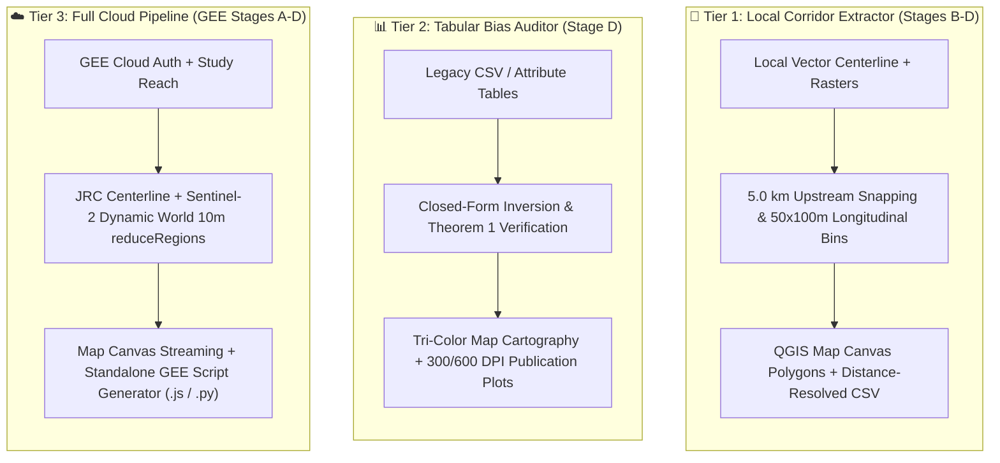

# WPDB Spatial Engine Documentation 🌊

**WPDB Spatial Engine** is an official QGIS Plugin and open-source scientific software package designed to identify, quantify, and eliminate **Water-Pixel Dilution Bias (WPDB)** in riverine spatial feature engineering and hydrological data science.

* **Step-by-Step User Tutorial:** [docs/tutorial.md](tutorial.md)
* **Author & Lead Architect:** Md Abu Sayem Sarker (Data Scientist & GeoAI Researcher)
* **Core Domains:** GeoAI · Remote Sensing · Machine Learning · Software Engineering
* **Official Repository:** [https://github.com/sayem088/QGIS_Plugin_WPDB_Spatial_Engine](https://github.com/sayem088/QGIS_Plugin_WPDB_Spatial_Engine)
* **Inquiries & Research Feedback:** [mdabusayemsarker9@gmail.com](mailto:mdabusayemsarker9@gmail.com)
* **LinkedIn:** [Abu Sayem Sarker](https://www.linkedin.com/in/mdabusayemsarker/)
* **License:** MIT License (Copyright 2026 Md Abu Sayem Sarker)

---

## The Core Mathematical Law

Conventional circular buffers compute terrestrial land cover fractions over total enclosed polygon area:
$$f_{\text{target, naive}} = \frac{A_{\text{target}}}{A_{\text{total}}} = \frac{A_{\text{target}}}{A_{\text{target}} + A_{\text{other}} + A_{\text{water}}}$$

`WPDB Spatial Engine` isolates terrestrial land cover by excluding unbuildable aquatic pixels from the denominator:
$$f_{\text{target, nw}} = \frac{A_{\text{target}}}{A_{\text{total}} - A_{\text{water}}} = \frac{f_{\text{target, naive}}}{1 - f_{\text{water}}}$$

This yields the exact closed-form measurement error:
$$\Delta f_{\text{target}} = - f_{\text{water}} \cdot f_{\text{target, nw}}$$

---

## 3-Tier Architecture Overview

---

## Empirical Verification in Dhaka Mega-City

Empirical validation across 11 monitoring stations on the Buriganga ($n=7$) and Shitalakhya ($n=4$) river systems confirmed that:
1. Conventional circular buffers deflated built-up density by an average of **$46.93$ percentage points** (ranging from $-27.19$ to $-56.34\text{ pp}$).
2. The closed-form analytical identity predicted observed distortion with **zero residual ($|\varepsilon| \le 0.01\text{ pp}$)** at all 11 stations.
3. At the Hazaribagh tannery cluster, non-water normalization restored true industrial built-up density from $26.5\%$ (misclassified by naive buffers as "Mixed Urban") to **$88.8\%$** ("Industrial Infrastructure").
