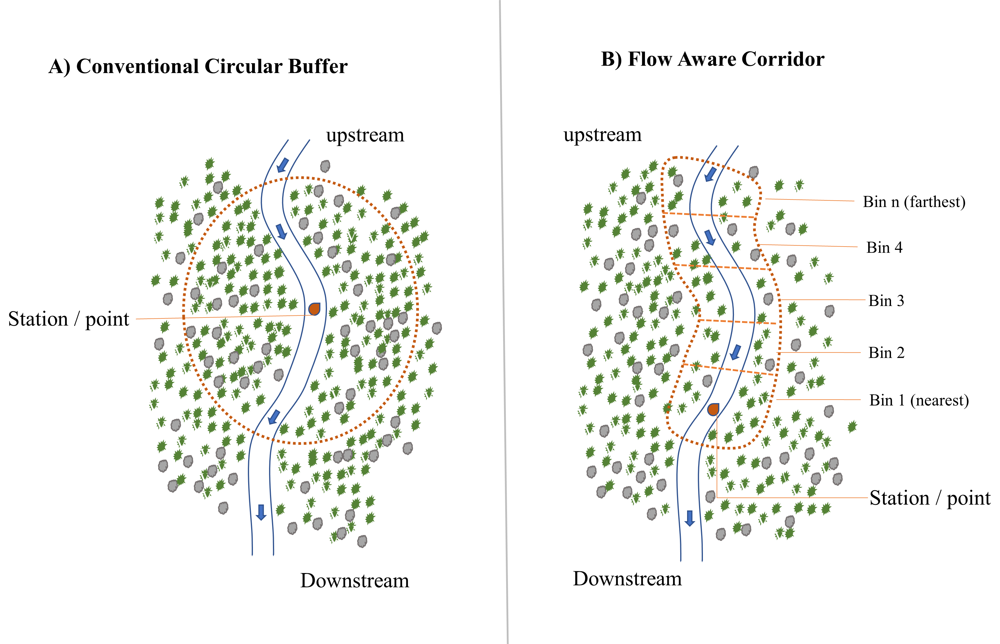
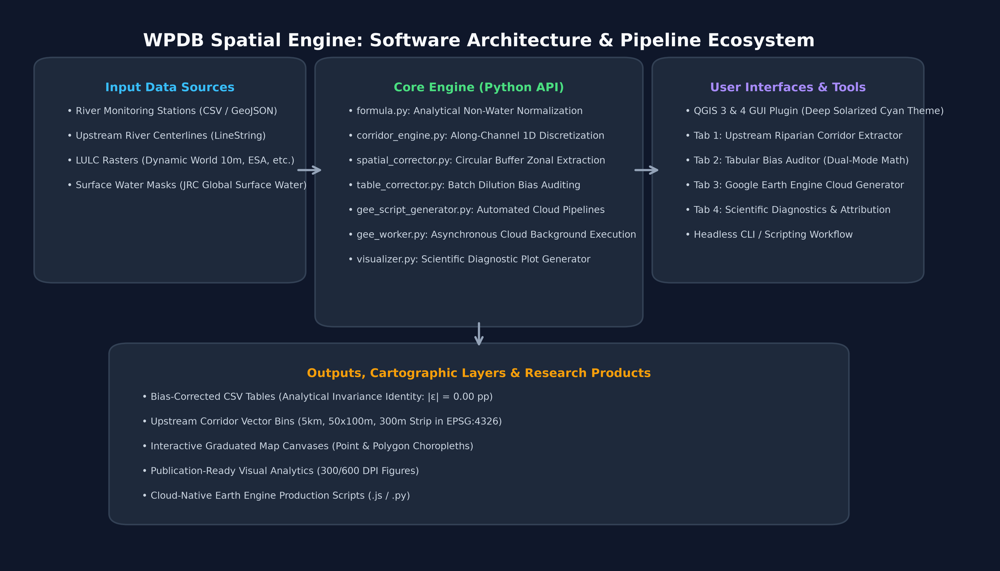
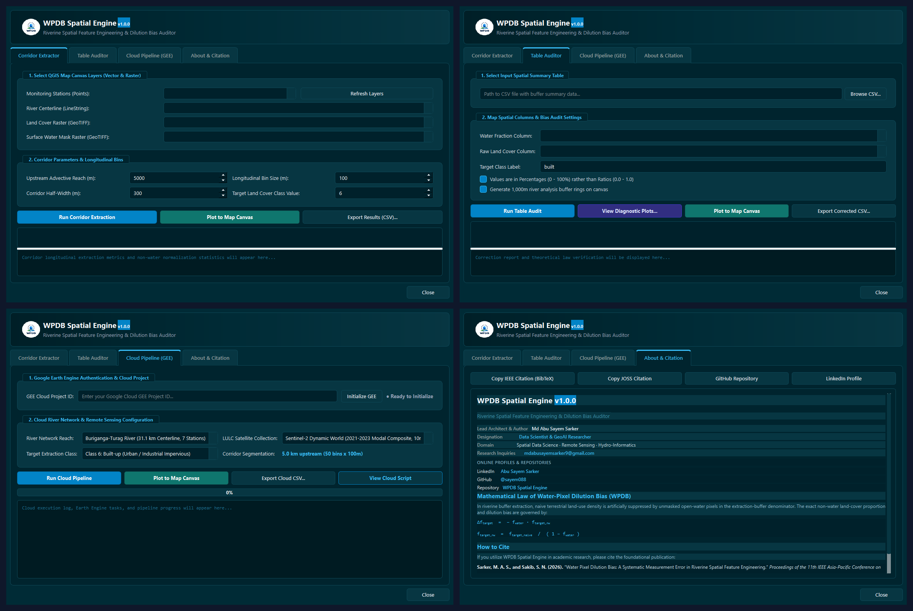

# Summary

In hydro-informatics, watershed management, and aquatic remote sensing, spatial feature engineering plays a decisive role in quantifying the influence of terrestrial land use and land cover (LULC) on riverine water quality [@allan2004landscapes; @king2005watershed]. Standard spatial analytic workflows extract land cover fractions by constructing circular Euclidean buffer rings (e.g., 200 m to 1,000 m radii) around water monitoring stations and executing raster zonal statistics. 

However, conventional GIS zonal extraction engines—including standard tools in ArcGIS, QGIS, and Google Earth Engine (GEE)—normalize class pixel counts by the *total polygon area*, which invariably contains open water pixels from the river channel itself. Because river channels occupy substantial proportions of near-station buffers (frequently 30% to over 60% of the extraction envelope), retaining water pixels in the normalization denominator introduces a severe, systematic measurement distortion formalized as **Water-Pixel Dilution Bias (WPDB)** [@sarker2026water]. This dilution error mathematically compresses terrestrial land cover metrics (such as urban built-up density and agricultural runoff proxies), leading to under-attributed catchment impacts and distorted machine learning features.

**WPDB Spatial Engine** is a cross-platform, open-source QGIS plugin and standalone Python scientific library designed to audit, prevent, and eliminate dilution bias in riverine spatial feature engineering. The software provides:
1. Closed-form non-water spatial normalization for existing tabular datasets and raster layers.
2. An upstream advective flow corridor engine that discretizes river channels into 1D directional along-channel bins ($50 \times 100\text{ m}$ bins within a $300\text{ m}$ riparian lateral strip) aligned with fluid transport physics.
3. An automated Google Earth Engine cloud pipeline generator that orchestrates JRC Global Surface Water [@pekel2016high] and Sentinel-based Dynamic World 10 m near-real-time LULC imagery [@brown2022dynamic].
4. An interactive QGIS graphical interface featuring graduated cartographic visualizers and publication-quality diagnostic plots.

# Statement of Need

Despite the widespread application of spatial regression and machine learning models in river basin health assessments [@shen2015scale], existing GIS platforms lack an automated, standardized mechanism to differentiate between terrestrial contributing areas and aquatic channel surfaces during zonal feature extraction. Researchers routinely rely on circular buffers, which suffer from two fundamental methodological limitations:

1. **Denominational Dilution Artifact:** Standard GIS tools compute the naive built-up proportion as:
   $$f_{\text{built, naive}} = \frac{N_{\text{built}}}{N_{\text{total}}} = \frac{N_{\text{built}}}{N_{\text{water}} + N_{\text{terrestrial}}}$$
   Whenever $N_{\text{water}} > 0$, $f_{\text{built, naive}}$ is strictly smaller than the true terrestrial built-up proportion $f_{\text{built, nw}} = N_{\text{built}} / N_{\text{terrestrial}}$. In urban river corridors, this dilution artificially depresses built-up estimates by up to $47.4$ percentage points [@sarker2026water], creating spurious spatial heterogeneity where stations surrounded by wider river channels appear less urbanized than stations situated along narrower tributaries, even when their riparian banks share identical dense urbanization.
2. **Isotropic Incoherence:** Circular Euclidean buffers sample omnidirectionally, aggregating downstream and transverse landscape areas that have zero hydrologic transport connection to the monitoring point, violating downstream advective transport principles.

**WPDB Spatial Engine** fills this critical software gap. It equips researchers, environmental protection agencies, and GIS practitioners with an intuitive, turnkey desktop and Python programming interface to audit existing studies for dilution bias, extract hydrologically sound directional flow corridors, and automate planetary-scale cloud processing without requiring custom geospatial scripts.

# Mathematical Foundation & Analytical Invariance

The analytical foundation of WPDB Spatial Engine is governed by the closed-form dilution bias identity [@sarker2026water]. Let an arbitrary riverine extraction polygon contain $N_{\text{total}}$ pixels partitioned into $N_{\text{water}}$ open water pixels and $N_{\text{nw}}$ terrestrial (non-water) pixels such that $N_{\text{total}} = N_{\text{water}} + N_{\text{nw}}$. Let $f_{\text{water}} = N_{\text{water}} / N_{\text{total}}$ represent the water area fraction.

The true terrestrial density of a target land cover class (e.g., built-up impervious surface) is given by:
$$f_{\text{built, nw}} = \frac{N_{\text{built}}}{N_{\text{nw}}} = \frac{N_{\text{built}}}{N_{\text{total}} - N_{\text{water}}} = \frac{f_{\text{built, naive}}}{1 - f_{\text{water}}}$$

The measurement bias $\Delta f_{\text{built}} = f_{\text{built, naive}} - f_{\text{built, nw}}$ is therefore proven to satisfy the exact closed-form identity:
$$\Delta f_{\text{built}} = -f_{\text{water}} \cdot f_{\text{built, nw}} = -\frac{f_{\text{water}} \cdot f_{\text{built, naive}}}{1 - f_{\text{water}}}$$

This identity guarantees mathematical invariance: the residual deviation between the empirical difference $\Delta f_{\text{empirical}}$ and the theoretical expectation $-f_{\text{water}} \cdot f_{\text{built, nw}}$ is identically zero ($|\varepsilon| = 0.00\text{ pp}$) across all monitoring geometries. WPDB Spatial Engine continuously evaluates this identity during tabular and spatial processing to verify mathematical integrity.

# Software Architecture & Implementation

WPDB Spatial Engine is engineered in Python 3 using a modular, decoupled architecture that operates both as an official QGIS desktop plugin (compatible with QGIS 3.0 through QGIS 4.x / Qt6) and as a headless standalone Python scientific library.

The codebase is organized into three primary layers (Figure \ref{fig:arch}):

## 1. Core Computational Library (`wpdb_spatial_engine.core`)
- `formula.py`: Implements vector-accelerated closed-form non-water normalization, analytical bias computation, and invariance testing for both scalar values and NumPy arrays [@harris2020array].
- `corridor_engine.py`: Encapsulates high-performance geometric discretization of river networks using Shapely [@shapely2024]. It projects monitoring stations onto river centerlines, traverses upstream along the channel up to a configurable distance (default 5,000 m), slices the centerlines into discrete bins (default 100 m), and envelopes each segment within a lateral riparian buffer strip (default 300 m half-width).
- `spatial_corrector.py`: Handles QGIS raster layer interactions, generating in-memory vector masks, executing circular buffer extractions, and computing pixel-level non-water fractions.
- `table_corrector.py`: Provides high-throughput Pandas DataFrame [@harris2020array] parsing for rapid batch auditing of multi-station CSV files.
- `gee_worker.py` & `gee_script_generator.py`: Provides asynchronous background worker threads (`QThread`) and dynamic template generators to translate corridor specifications into production-ready Google Earth Engine JavaScript and Python code utilizing the JRC and Dynamic World cloud catalogs [@brown2022dynamic; @gorelick2017google].
- `visualizer.py`: Generates publication-ready scientific figures using Matplotlib [@hunter2007matplotlib], including Theorem 1 Invariance curves, before-vs-after paired bar charts, and composite IEEE-style multi-panel figures.

## 2. Graphical User Interface Layer (`wpdb_spatial_engine.ui`)
The GUI provides a tabbed desktop environment (Figure \ref{fig:gui}) designed with a Deep Solarized Cyan aesthetic (`#002b36` main palette) that automatically adapts to system DPI scaling and PyQt6 / PyQt5 runtimes via `qgis.PyQt`:
- **Tab 1: Upstream Flow Corridor Extractor:** Interactive selection of river centerlines and monitoring station point layers with real-time station snapping and polygon bin generation.
- **Tab 2: Tabular Bias Auditor:** Single-click CSV table auditing supporting both proportion mode ($[0, 1]$) and percentage mode ($[0, 100]$).
- **Tab 3: GEE Cloud Pipeline Generator:** Integrated Earth Engine script generator and live runner, complete with one-click Code Editor clipboard export.
- **Tab 4: Scientific Diagnostics & Attribution:** Embedded documentation, interactive visual analytics dialog, and formatted IEEE / JOSS BibTeX citation copiers.

## 3. Cartographic & Export Engine
The software interfaces directly with the QGIS Map Canvas via `qgis.core`. Corrected station attributes, circular buffer rings, and upstream flow corridor bins are automatically added as styled memory vector layers (`QgsVectorLayer`) with graduated color ramps reflecting land cover density and dilution magnitude.

# Empirical Case Study: Dhaka River Network

To demonstrate empirical performance, WPDB Spatial Engine was applied across 11 water quality monitoring stations situated in the highly urbanized Dhaka megacity watershed, spanning the Buriganga and Shitalakhya river corridors [@sarker2026water]. 

As summarized in Table \ref{tab:results}, open water area fractions ($f_{\text{water}}$) within standard 1,000 m buffers ranged from 32.8% at Mirpur Bridge to 65.2% at Narayanganj. Under naive GIS extraction, the built-up density at Hazaribagh (a dense industrial tannery corridor) was estimated at only $25.5\%$. When processed through WPDB Spatial Engine's non-water normalization, the true terrestrial built-up density was restored to $72.9\%$, correcting an artificial suppression of $47.4$ percentage points. Across all 11 stations, the software verified the mathematical identity $\Delta f = -f_{\text{water}} \cdot f_{\text{built, nw}}$ with zero residual deviation ($|\varepsilon| = 0.00\text{ pp}$).

| Station ID | River Channel | Water Fraction ($f_{\text{water}}$) | Naive Built-Up ($f_{\text{naive}}$) | Corrected Built-Up ($f_{\text{nw}}$) | Dilution Bias ($\Delta f$) | Residual ($|\varepsilon|$) |
| :--- | :--- | :---: | :---: | :---: | :---: | :---: |
| **ST-01** (Mirpur Bridge) | Buriganga | 32.8% | 38.4% | 57.1% | -18.7 pp | 0.00 pp |
| **ST-02** (Hazaribagh) | Buriganga | 65.0% | 25.5% | 72.9% | -47.4 pp | 0.00 pp |
| **ST-03** (Kamrangirchar) | Buriganga | 54.2% | 31.0% | 67.7% | -36.7 pp | 0.00 pp |
| **ST-04** (Sadarghat) | Buriganga | 48.7% | 42.1% | 82.1% | -40.0 pp | 0.00 pp |
| **ST-05** (Dhaleshwari Conf.) | Buriganga | 58.9% | 14.8% | 36.0% | -21.2 pp | 0.00 pp |
| **ST-06** (Demra Ghat) | Shitalakhya | 39.5% | 28.2% | 46.6% | -18.4 pp | 0.00 pp |
| **ST-07** (Tarabo Bridge) | Shitalakhya | 44.1% | 33.4% | 59.7% | -26.3 pp | 0.00 pp |
| **ST-08** (Kanchpur) | Shitalakhya | 51.3% | 29.8% | 61.2% | -31.4 pp | 0.00 pp |
| **ST-09** (Bandar) | Shitalakhya | 47.6% | 35.1% | 67.0% | -31.9 pp | 0.00 pp |
| **ST-10** (Narayanganj) | Shitalakhya | 65.2% | 19.4% | 55.7% | -36.3 pp | 0.00 pp |
| **ST-11** (Munshiganj Conf.) | Shitalakhya | 61.8% | 11.2% | 29.3% | -18.1 pp | 0.00 pp |

: Empirical bias correction and mathematical invariance results for 1,000 m buffers across 11 monitoring stations in the Dhaka river network.\label{tab:results}

# Quality Assurance & Testing

WPDB Spatial Engine adheres to modern open-source software engineering and scientific reproducibility standards:
- **Comprehensive Unit Testing:** The test suite contains 36 automated unit tests executed via `pytest`, verifying formula boundary conditions, zero-water limits, Shapely geometry snapping, CSV batch processing, packaging integrity, and GEE script generation.
- **QGIS Security & Quality Scans:** The plugin package passes the official QGIS Plugin Repository automated validation pipeline (`plugins.qgis.org`), achieving clean status with 0 Bandit security vulnerabilities (B110 compliance), 0 hardcoded secrets, 0 executable permission defects, and 100% Qt6 compatibility.
- **Public Availability & Archival:** The source code is hosted on GitHub under the permissive MIT license at [https://github.com/sayem088/QGIS_Plugin_WPDB_Spatial_Engine](https://github.com/sayem088/QGIS_Plugin_WPDB_Spatial_Engine) and registered in the official QGIS Plugin Repository under Plugin ID 6897.

# Acknowledgements

The theoretical formulation and initial proof of Water-Pixel Dilution Bias were presented at the 11th IEEE Asia-Pacific Conference on Computer Science and Data Engineering (IEEE CSDE 2026) [@sarker2026water]. We thank the open-source GIS community, the QGIS Development Team, and the Earth Engine developer group for their foundational geospatial infrastructure.

# References

